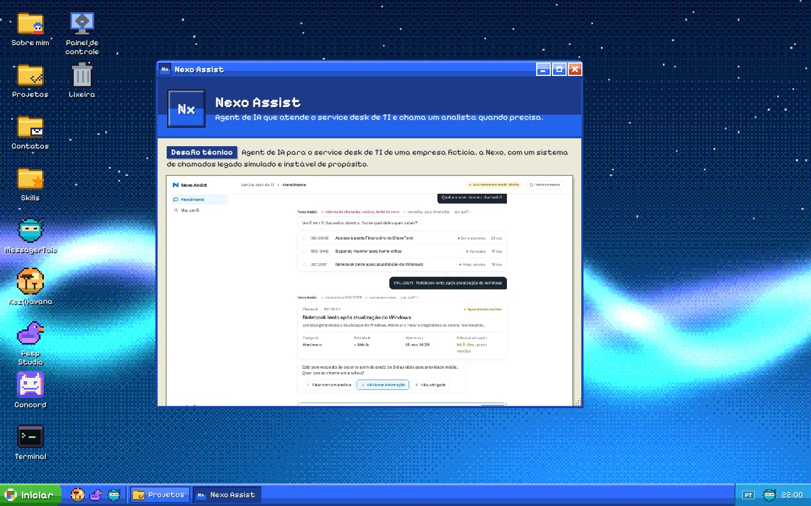

# aluOS — portfolio do Aluísio

Portfolio em forma de sistema operacional em pixel art, no clima dos desktops de 2004–2007
e de jogos como *Emily is Away* e *Killer Frequency*.

**[Abrir o aluOS](https://aluisiodev.github.io/)**



## O que tem no desktop

- **Pastas:** Sobre mim, Projetos, Contatos e Skills, abertas num explorador de arquivos.
- **Projetos:** cada projeto abre numa janela com capturas de tela (clique para ampliar), contexto (cliente, trabalho de curso, APS, projeto pessoal), o problema que resolve, como funciona, destaques, o que aprendi, equipe, stack e links para o site e o código.
- **Sobre mim:** `sobre_mim.txt` (bloco de notas) e `quarto_360.png`, um quarto panorâmico 360° com objetos clicáveis.
- **MessagerTale:** messenger que começa com notificações no canto da tela. O visitante escolhe as respostas,
  a frase é "digitada" (qualquer tecla acelera) e o `aluisio.dev` responde.
- **Kez(i)avana:** navegador da savana, com as páginas *bootleg* LigadIn e DogHub (os botões "Sair da savana" levam aos perfis reais), o buscador Alulugle (página inicial), o YouInTheScreenOfComputerOrPhone, o e-mail imaíu, o clicajogos (Cobrinha, Jogo da velha, Pato Clicker e Memória), o musikzify (playlist com prévia pelo player do Spotify), o fórum ebaa!, o Clima da Selva de Pedra (dados reais do Open-Meteo), a rede social yakurt e a Kezpédia.
- **Peep Studio:** IDE de verdade. Na pasta `meus-codigos` dá pra criar arquivos `.py`, `.js` e `.cs` e executar no navegador: Python pelo Pyodide (em `js/vendor/pyodide`, código aberto), JavaScript num Web Worker e C# pela API do Piston, com um "C# de bolso" (tradução para JavaScript) quando o servidor não responde.
- **MessagerTale:** além do roteiro, tem conversa livre com um bot no estilo SimSimi, que aprende frases (`ensina: frase = resposta`). Para usar uma IA de verdade, veja "Servidor do aluOS" abaixo.
- **Zizi:** a assistente virtual do aluOS. Mostra o sistema, ensina a assinar o livro de visitas com um commit no Peep Studio, dá dicas e joga Jogo da velha provocando você.
- **Segredos:** 22 conquistas escondidas pelo sistema. O Painel de controle mostra quantas você já achou.
- **Peep Studio:** IDE do patinho roxo, com `Aluisio.cs` e um README de cada projeto. O botão ▶ Executar "roda" o código.
- **Terminal**, **Painel de controle** (papel de parede e cor das janelas) e **Lixeira**.

Feito só com HTML, CSS e JavaScript, sem build. O quarto 360° usa three.js r128 (em `js/vendor`, licença MIT).

## Editar o conteúdo

Tudo fica em [`js/data.js`](js/data.js): perfil, contatos, skills, certificações, projetos e os pontos clicáveis do quarto.
As capturas dos projetos ficam em `img/projetos/` (WebP, 960 px de largura) e entram no campo `imagens` de cada projeto.
A versão em inglês dos projetos fica em [`js/i18n.js`](js/i18n.js).
Os campos com `TODO` ainda precisam do seu texto.

### Trocar a imagem do quarto

Coloque uma imagem equirretangular (proporção 2:1, por exemplo 4096×2048) em `img/` e aponte `QUARTO.imagem` para ela.
Cada ponto clicável tem `u` e `v` de 0 a 1: a posição do objeto na imagem dividida pela largura e pela altura.
A imagem atual foi gerada por código como placeholder.

## Servidor do aluOS e estatísticas

Tudo funciona sem servidor, mas aí placar, ranking e livro de visitas ficam só no navegador de cada pessoa.

- **Servidor (grátis, Cloudflare Workers):** `worker/aluos-worker.js` guarda o placar global do Jogo da velha ("All users" × "Zizi"), o ranking dos jogos, o livro de visitas e, opcionalmente, o chat com IA. O passo a passo está no topo do arquivo. Depois coloque a URL em `ALU.CONFIG.api` (`js/data.js`).
- **Quem assinou o livro de visitas:** abra `https://SEU-WORKER.workers.dev/visitas?chave=SUA_CHAVE_ADMIN`.
- **GoatCounter (visitas, sem cookies):** crie a conta em https://www.goatcounter.com/signup e coloque o código em `ALU.CONFIG.goatcounter`. Ele conta visitas, países, de onde a pessoa veio e quais apps ela abriu. Quem assina o livro de visitas também aparece lá como evento.

## Rodar no computador

```bash
python3 -m http.server 8000   # ou: npx serve .
```

Abra http://localhost:8000.

## Arquivos

```
index.html        estrutura e boot
css/style.css     visual pixel art
img/              foto, papéis de parede e quarto 360°
js/data.js        conteúdo  <- EDITE
js/pixel.js       ícones em pixel art, desenhados em código
js/apps.js        registro de apps, pastas, bloco de notas, propriedades
js/chat.js        MessagerTale: roteiro da conversa e sons
js/kez.js         navegador Kez(i)avana e suas páginas
js/sites.js       sites do Kez(i)avana (vídeos, e-mail, jogos)
js/jogos.js       joguinhos do clicajogos
js/eggs.js        easter eggs e conquistas
js/sites2.js      alulugle, musikzify, ebaa!, clima, yakurt e Kezpédia
js/bot.js         bot do MessagerTale
js/buddy.js       Zizi, a assistente virtual
js/peep*.js       Peep Studio, o executor (worker) e o C# de bolso
worker/           Cloudflare Worker opcional para a IA do chat
js/peep.js        IDE Peep Studio
js/quarto.js      visualizador 360°
js/terminal.js    terminal
js/desktop.js     janelas, barra de tarefas, menu iniciar, notificações
js/mobile.js      modo celular (em pausa por enquanto)
js/main.js        estado, papéis de parede, boot
```
